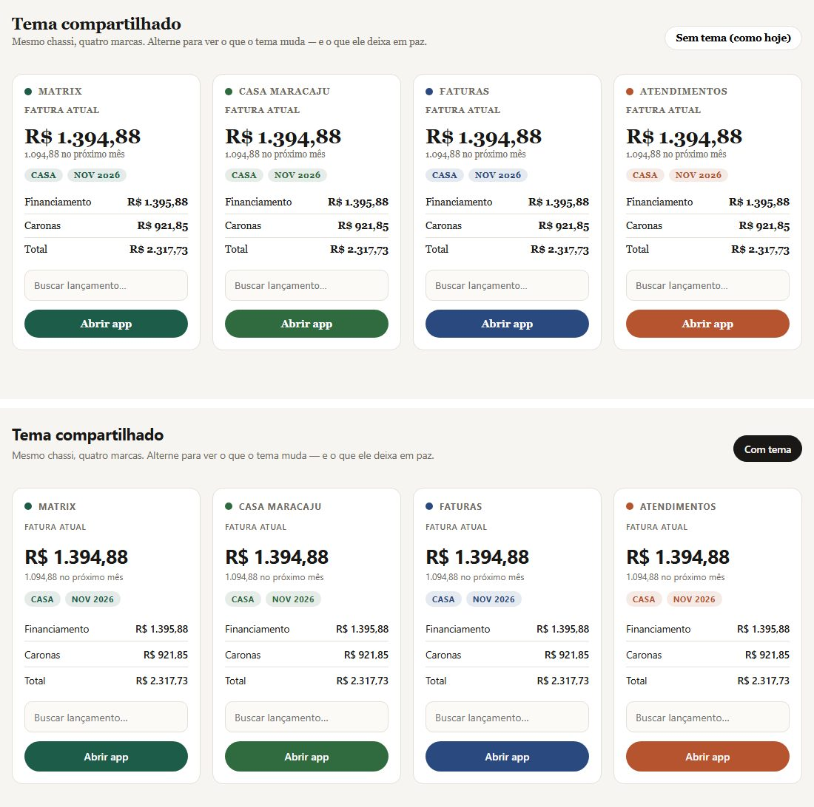
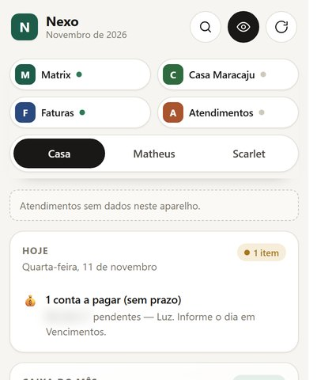
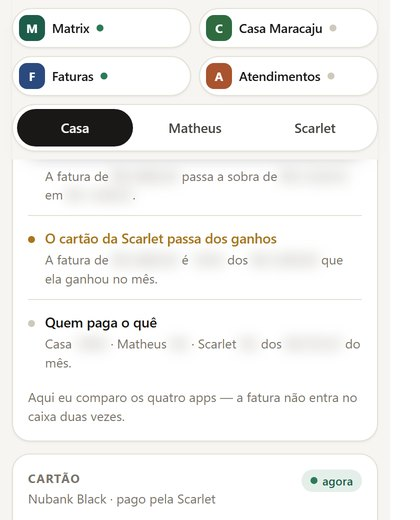
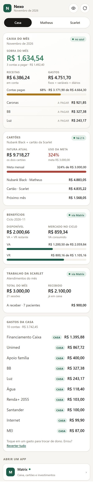
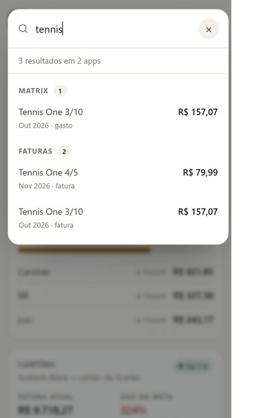

# 🜂 Nexo — uma casa, três olhares

> **No ar:** <https://matheusdochapeu-hub.github.io/Nexo/>

> Camada unificada sobre os quatro apps da casa: **Matrix**, **Casa Maracaju**,
> **Faturas** e **Atendimentos**. Começa como um shell de leitura; cresce em fases.

**Versão 0.10.0 — Fase 3 em andamento.** Nenhum dos quatro apps foi alterado, e nenhum
depende do Nexo para funcionar.











---

## O que já existe

Três áreas, uma linguagem visual só:

| Área | Mostra |
|---|---|
| 🏡 **Casa** | sobra do mês, receitas, gastos, contas a pagar, cartões dos dois, VA/VR, trabalho da Scarlet, **gastos da casa** |
| 🧑🏻 **Matheus** | **seus gastos**, receitas do mês, cartão Black, fatura |
| 👩🏻 **Scarlet** | ganhos dos atendimentos, recebido × a receber, sessões, pacientes, **seus gastos** |

Mais:

- **Nuvem opcional** (v0.9.0): regras de dono sincronizadas por Apps Script.
- **Ajustes que viajam** (v0.8.0): exportar/importar regras e privacidade em JSON.
- **Lista canônica de faturas** (v0.7.0): o Nexo lê a lista do dono e ignora a cópia do Matrix.
- **Tema compartilhado** (v0.6.0): um CSS opt-in que unifica o chassi dos quatro apps.
- **Hoje** (v0.5.0): o dia em uma lista — tarefas, atendimentos, recarga de VA/VR e contas.
- **Conciliação cruzada** (v0.4.0): o que só o Nexo consegue ver, cruzando os quatro apps.
- **Busca global manual** (v0.3.0): um campo que varre os quatro apps de uma vez.
- **Separação por pessoa** (v0.2.0): cada gasto tem um dono — Casa, Matheus ou Scarlet.
  Veja abaixo como funciona.
- **Lançador** com os quatro apps e um ponto de status (lido / não aberto).
- **Modo privacidade** (olho no topo): esconde todos os valores na hora; a preferência fica
  salva no próprio Nexo.
- **Avisos honestos**: dado velho (> 6 h) vira chip "desatualizado"; fonte ausente vira
  "—", nunca zero inventado.
- **PWA instalável** com escopo próprio (`/nexo/`), sem tocar no cache dos outros apps.

---

## Separação por pessoa

Cada gasto recebe um **dono** antes de qualquer soma, com um padrão que já faz sentido:

| Lançamento | Dono padrão | Por quê |
|---|---|---|
| Contas fixas, variáveis e de início de ano | 🏡 Casa | água, luz, financiamento, caronas |
| Diário pago com VA/VR | 🏡 Casa | comida da casa |
| Diário no débito ou no cartão | 🧑🏻 Matheus | gasto do dia a dia dele |
| Receita de benefício (VA/VR) | 🏡 Casa | não é dinheiro em conta |
| Salário, freela, estúdio | 🧑🏻 Matheus | renda dele |

**Trocar é um toque.** Em qualquer gasto com selo, tocar alterna
**Casa → Matheus → Scarlet → Casa**. A escolha vira uma regra pelo *nome do lançamento* e vale
para os meses seguintes (mudou o valor, não muda o dono). `Reverter tudo` (no cartão
"Gastos da casa") limpa as regras e volta ao padrão.

As regras ficam em `nexo_regras`, só no Nexo — nenhum dos quatro apps sabe que elas existem.
O total da casa **não muda** ao atribuir: só a divisão entre as três colunas muda.

---

## Busca global (manual, sem bot)

Um campo só — a lupa no topo, `/` no teclado ou `Ctrl/Cmd + K` — que procura ao mesmo tempo
em **Matrix, Faturas, Atendimentos e Casa Maracaju**. Você digita; ele filtra o que já está
no navegador. Não há assistente, sugestão automática nem requisição de rede.

O que dá para digitar:

| Você digita | Ele encontra |
|---|---|
| `carona` | a conta do Matrix (e ignora acento: `agua` acha `Água`) |
| `921,85` ou `921.85` | o lançamento com exatamente esse valor |
| `novembro` | tudo daquele mês, em qualquer app |
| `tennis` | o item no Matrix **e** na fatura, agrupados por app |
| `louça`, `óleo`, `serra gaúcha` | tarefas, carro e sonhos do Casa Maracaju |

Os resultados vêm agrupados por app (Matrix → Faturas → Atendimentos → Casa Maracaju), com
mês, tipo e valor. Cada linha é um atalho para o app de origem. Máximo de 60 resultados, com
o total real informado quando corta.

---

## Conciliação cruzada

O cartão **Conciliação** (logo abaixo do caixa) cruza o que cada app enxerga sozinho e
devolve achados com três tons: 🔴 risco, 🟡 atenção, 🟢 ok (e ⚪ informação).

| Achado | Cruzamento | Exemplo |
|---|---|---|
| **Benefício estourou / no limite / com folga** | VA/VR gasto × total do ciclo | "R$ 50 passaram do VA/VR no ciclo. Esse excedente saiu do bolso." |
| **Fatura acima da meta** | fatura × meta e × receitas | "R$ 6.718 acima da meta — 324% usado." |
| **A fatura come a sobra** | fatura × sobra do mês | "A fatura passa a sobra em R$ 8.083." |
| **A fatura já está no fluxo** | procura pagamento de cartão nas contas | "Encontrei 1 lançamento de cartão. Comparo, mas não somo de novo." |
| **Quem paga o quê** | divisão por dono | "Casa 79% · Matheus 2% · Scarlet 19%." |
| **Cartão da Scarlet × ganhos** | fatura dela × o que ela faturou | "A fatura é 161% do que ela ganhou no mês." |

**A regra que sustenta tudo:** aqui se **compara**, não se soma. A fatura nunca entra no caixa
de novo — se o Matrix já lançou o pagamento, o achado vira aviso ("já está no fluxo") em vez
de inflar o total. É a mesma trava "uma compra, uma soma" dos outros apps, aplicada ao
cruzamento.

---

## Hoje

O primeiro card da Casa responde "o que tem para hoje?", sempre na mesma ordem:
**atrasado → hoje → amanhã → próximo → mês**.

| Item | De onde vem a data |
|---|---|
| 🧹 Tarefas do lar | `tasks` + `history[data][taskId]` do Casa Maracaju |
| 🩺 Atendimentos | `ft_local_schedules` do Atendimentos (`data`, `hora`; cancelado não conta) |
| 💳 Recarga de VA/VR | `creditDate` do satélite (4º dia útil), só quando faltam até 7 dias |
| 💰 Contas a pagar | `pago: false` no mês do Matrix + o **dia de vencimento que você informa** em Vencimentos |

**Só entra o que tem data de verdade.** O Matrix registra `pago: true/false` mas **não guarda
data de vencimento** — então o Nexo não inventa "vence amanhã". Você informa o dia em
**Vencimentos** (um campo por conta em aberto) e a partir daí o "Hoje" avisa:
*conta vencida* (vermelho), *vence hoje*, *vence em até 3 dias*. Conta sem dia informado
continua aparecendo como "a pagar (sem prazo)" — nunca como alarme falso.

O dia é por **nome da conta** e vale para todos os meses (dia 31 vira 30/28 quando o mês é
mais curto). Fica em `nexo_vencimentos`, só no aparelho.

> Push notification de verdade exige servidor (o Nexo não tem backend). O "Hoje" é a
> versão honesta: a informação pronta na abertura, sem prometer o que não pode entregar.

---

## Lista canônica de faturas (fim da cópia)

Os itens de fatura existem **duas vezes** hoje: no `index.html` do Faturas (o dono, 91
itens) e numa cópia dentro de `matrix/js/satellite-connectors.js` (90 itens). Cópia
diverge: é uma questão de tempo.

`npm run drift` lê os dois arquivos e compara o **efeito**, não o texto — porque o Matrix
aplica os ajustes que você fez no Faturas (`-1` = apagado, valor = editado):

```
✔ Nada a corrigir: todas as diferenças são ajustes seus no app Faturas.

  Apagados por você (1):
    · Cobertura 5/10 — R$ 1246  ⟵ -1 no mês 4
  Valor editado por você (1):
    · Cotton On 2/3: lista R$ 69.97 → ajustado R$ 69.95
```

Quando aparece algo **sem** explicação, ele acusa "divergência real" — e aí sim há o que
consertar. A investigação completa está em [docs/diagnostico-faturas.md](docs/diagnostico-faturas.md).

`nexo/shared/faturas-base.json` (e o espelho `.js`) é a **lista canônica**, gerada do
dono por `npm run drift:gerar`. O Nexo já a consome:

| Situação do aparelho | Fonte usada |
|---|---|
| Tem ajustes do Faturas (`pv4_over`/`pv4_extra`) | **lista canônica + ajustes** → chip "via Faturas" |
| Nunca abriu o Faturas | satélite do Matrix (pode carregar o drift) |
| Nenhuma das duas | `—` |

Ou seja: o Nexo já parou de herdar a divergência, **sem editar nenhum app**. Para os
apps pararem também, falta cada um ler o arquivo compartilhado — decisão do dono.

---

## Nuvem (Apps Script, opcional)

Sem isso, cada aparelho tem as suas regras. Com isso, as regras viajam.

1. Planilha nova no Google Sheets → **Extensões → Apps Script**.
2. Cole `apps_script.gs`, salve.
3. **Configurações do projeto → Propriedades do script** → `NEXO_TOKEN` = uma senha longa.
4. **Implantar → Nova implantação → App da Web** · executar como **Eu** · acesso
   **Qualquer pessoa**.
5. Copie a URL `/exec` e cole em **Nexo → Ajustes → Nuvem**, junto com o token.

O que viaja: **só as regras de dono**. Privacidade é preferência de cada aparelho e não é
aplicada da nuvem. O token fica só no aparelho — nunca vai no backup nem para a planilha.

**Como sincroniza:** leitura por JSONP (o Apps Script não manda CORS), escrita por POST
`no-cors` confirmada por uma leitura seguinte. Conflito é detectado por **revisão**: se a
planilha mudou entre ler e gravar, a regra vence quem tiver o `em` mais recente — ninguém
sobrescreve o outro em silêncio.

---

## Ajustes que viajam

As regras de dono (`nexo_regras`) e a preferência de privacidade vivem no `localStorage` de
**cada aparelho**. Sem backend, a forma honesta de levar isso para o celular é um arquivo:

- **Exportar** → baixa `nexo-ajustes-AAAA-MM-DD.json` com regras + privacidade;
- **Importar** → valida antes de aplicar: recusa JSON quebrado, arquivo de outro app,
  versão futura e regra com dono/tipo desconhecido. Regras inválidas são descartadas e
  contadas na mensagem ("Importados 3 ajustes · 1 descartado");
- **Reverter** → volta tudo ao padrão.

O bloco fica no fim da página, em todas as abas, com o contador de regras.

---

## Tema compartilhado

`theme/nexo-theme.css` unifica o **chassi** dos quatro apps — tipografia, forma, foco,
números e movimento — sem repintar a identidade de cada um. Mesmo chassi, quatro marcas.

Abra `theme/demo.html` e alterne **Com tema / Sem tema**. Adoção é uma linha, rollback é
apagar essa linha. Detalhes, riscos e ordem sugerida em [theme/README.md](theme/README.md).

**Nenhum app foi alterado ainda** — a adoção é decisão do dono, um app por vez.

---

## De onde vêm os números

O Nexo **não tem backend, não tem conta, não faz requisição de rede**. Ele lê o
`localStorage` que os quatro apps já gravam na mesma origem
(`matheusdochapeu-hub.github.io`):

| Fonte | Chave lida | O que o Nexo aproveita |
|---|---|---|
| Matrix | `MATRIX_FINANCE_STATE_v2` | `anos[ano][Mês]` (fixos, variáveis, diários, receitas, nó `scarlet`) e `satellites.*` já normalizados |
| Casa Maracaju | `MARACAJU_STATE_v1` | `settings.benefitsSummary` (VA/VR), `tasks` + `history` (o "Hoje") e os itens para a busca |
| Faturas | `pv4_over`, `pv4_extra`, `pv4_profile` + lista canônica | fatura atual recalculada do dono; cai no satélite do Matrix só se o aparelho nunca abriu o Faturas |
| Atendimentos | `ft_local_entries` e `ft_local_schedules` | lançamentos do mês e a agenda de hoje/amanhã |

**Regra de ouro:** o Nexo nunca escreve nessas chaves. As únicas chaves que ele grava são
`nexo_*` (preferências dele).

---

## Como rodar

Os cinco apps precisam sair da **mesma origem**, senão o `localStorage` não é compartilhado.
Na pasta `5. IA`:

```powershell
python -m http.server 8000
# Nexo:      http://localhost:8000/nexo/
# Matrix:    http://localhost:8000/matrix/
# Maracaju:  http://localhost:8000/maracaju88/
# Faturas:   http://localhost:8000/parcelado-a-vista/
# Atend.:    http://localhost:8000/matheus-app-fisioterapia/
```

Abrir por `file://` funciona para ver a tela, mas quebra o Service Worker e não compartilha
o `localStorage` com os outros apps.

No GitHub Pages o Nexo fica em `/Nexo/` — os links do lançador são resolvidos sozinhos
(`js/config.js` escolhe `remoto` quando o host é `github.io`).

---

## Testes

```powershell
node --test test/*.test.js
```

100 testes: normalização de números pt-BR, escolha de mês (com fallback de ano), soma de
caixa sem contar VA/VR nem diários já alocados, cartões, benefícios pela diferença,
trabalho pela satélite e pelos lançamentos locais, dados velhos, fontes ausentes,
atribuição por pessoa, busca (acento, valor, mês, agrupamento, limite, vazio),
conciliação (ordem dos tons, excedente, duplicidade, placeholders), alertas do dia
(diárias, semanais, agenda, recarga, contas, ordem), faturas (âncora de meses, overrides,
`-1`, extras, simulação), ajustes (validação, dedupe, ida e volta, versão futura) e a
guarda de versão.

---

## Versão

Uma versão, quatro lugares — igual aos outros apps:

1. `package.json` → `version`
2. `js/config.js` → `VERSION`
3. `sw.js` → `CACHE_NAME` (`nexo-vX.Y.Z`)
4. `index.html` → `?v=X.Y.Z` de **todos** os assets

O teste `versao.test.js` reprova se algum divergir.

---

## Próximas fases

- **Fase 3.2 (opcional)** — aposentar a cópia: Matrix e Faturas lerem `shared/`. Hoje não há
  divergência real (as diferenças são ajustes do dono), então isso é dívida arquitetural,
  não bug.
- **Fase 3.1 (pendente)** — adotar o tema em um app, um por vez.

---

## Limites conhecidos

- A separação por pessoa é de **atribuição**, não de conta bancária: o Nexo não sabe de
  qual conta saiu o dinheiro, sabe de quem é o gasto (e você ajusta com um toque).
- Receitas ainda não são atribuíveis pelo toque — todas as receitas não-benefício vão para
  o Matheus. Se a Scarlet passar a ter receita lançada no Matrix, isso precisa mudar.
- Sem dados no navegador, o Nexo mostra a tela de "abra um app uma vez" — não busca nada.
- O satélite do Matrix usa o mês de calendário; o ciclo de benefícios (VA/VR) é outro
  conceito e aparece como `ciclo` no cartão de benefícios.

Licença MIT.
